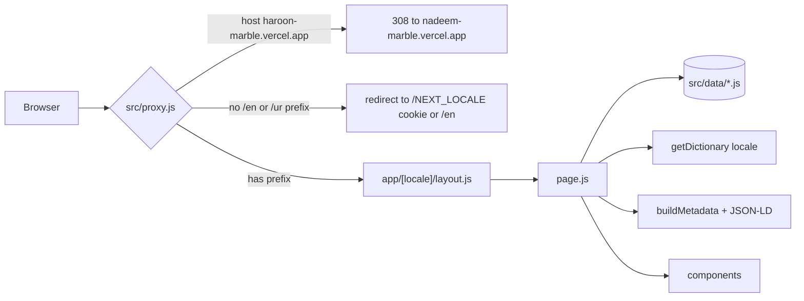
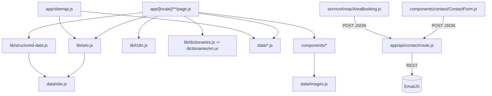
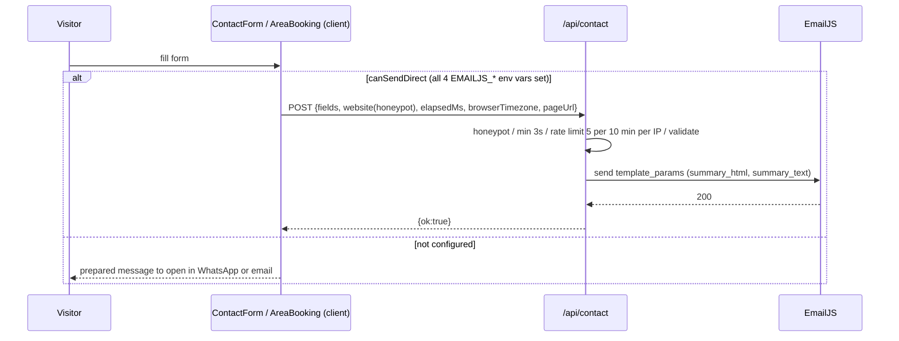

# Architecture

Static, prerendered Next.js App Router site. All content is local JS data in `src/data/` plus UI strings in `src/dictionaries/`. The only server-side runtime logic is the locale proxy and `POST /api/contact`.

## Folder structure

```
src/
  proxy.js                 locale redirect + old-host 308 (Next 16 "proxy" = middleware)
  app/
    globals.css            Tailwind 4 theme tokens, prose-article styles
    global-not-found.js    404 for URLs outside /en, /ur
    sitemap.js robots.js   metadata routes
    api/contact/route.js   contact form -> EmailJS
    [locale]/              every page; layout.js = <html lang dir>, Header, Footer, toploader, Lenis
      page.js              home
      about, services, services/[slug], portfolio, portfolio/[slug], industries,
      blog, blog/[slug], service-areas, service-areas/[area], contact,
      privacy-policy, terms, image-credits, not-found.js, [...rest] (-> notFound)
  components/
    layout/  header, nav (desktop/mobile), footer, language switcher, floating WhatsApp, SmoothScroll
    home/    hero, gallery, sectors, visualizer/ (three.js 3D floor preview)
    shared/  PageHeader, CtaBand, RegistryImage, SectionHeading, Breadcrumbs, LegalPage, PhoneMockups ...
    proof/   stats, FAQ, why-choose, testimonials (empty data -> hidden)
    serviceAreas/ AreaDirectory (search + letter filter), AreaBooking (form), ServiceGrid
    blog/ portfolio/ cards/ contact/ seo/JsonLd  ui/ (shadcn on Base UI)
  data/       content and business facts (see BUSINESS_LOGIC.md)
  dictionaries/ en.js, ur.js (UI strings, same shape)
  lib/        i18n, seo, structured-data, dictionaries (server-only), fonts, format, navMenus, smoothScroll
  hooks/      useLazyGsap
public/images/  logo, og-default.jpg, stock/*.webp
scripts/      generate-brand-assets.mjs, optimize-images.mjs (sharp; dev tools)
seo-tools/    local Google Search Console report script (not deployed with the site logic)
```

## Request flow



Proxy matcher skips `_next/`, `api/` and any path with a file extension.

## Module relationships



## Contact data flow



## Rendering

- All routes use `generateStaticParams` (locales, slugs) and are prerendered; unknown slugs call `notFound()`.
- Locale layout sets `lang`/`dir` (`ur` = rtl) and fonts (Manrope, Cormorant Garamond, Noto Nastaliq Urdu).
- Client-only pieces: forms, explorers/filters, motion (GSAP lazy via `useLazyGsap`), Lenis, 3D visualizer (three.js loaded with dynamic `import()`).
- No database, auth, sessions, uploads or global state store.
